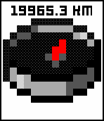
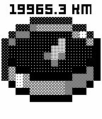
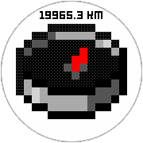
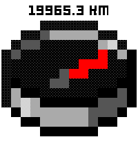
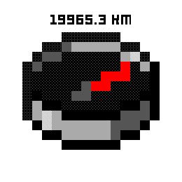

# Compass
A Minecraft style compass for the Pebble watches. 

[Pebble Store Link](https://apps.repebble.com/TODO)

## Features & Updates:
v1.0.:
- Real North compass function
- Option to set up to 5 custom locations
- Distance to custom locations
- Imperial/Metric toggle
- Support for all Pebbles (except original Pebble 2 which has no built-in compass)

## How to use
When first using the app you may need to calibrate your watch (You'll notice this on the 'X' visible on-screen). 
To calibrate your watch, remove it from your wrist and move it in an 8-like motion. While calibrating you will see a 'C'. 
Ideally you keep on going till the C disappears for best results.

By pressing SELECT you can set your heading. By default it is set to 'North'. 
You can add up to 5 locations in the app-configuration by giving a name and the coordinates of that location (use a tool like Google Maps to get these coordinates).
Once you saved your configuration, these locations will be visible on the watch as well. 
When you select a location the needle of the compass will point to this location and also show the distance to that location. 

## Good to know
I've done limited tests with this. The compass isn't always super accurate on my pebble and may require re-calibration from time to time.
You can also force re-calibration by exiting out of the application and temporary connecting the charger to your pebble. 
Then when re-opening the app redo the callibration motion.